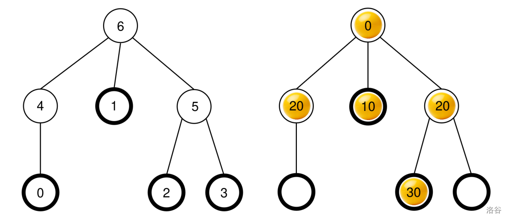
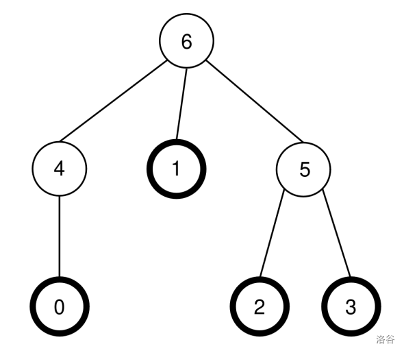
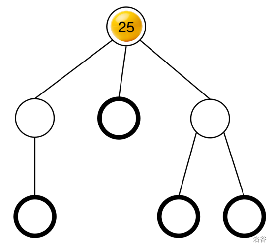

# [IOI 2026] 弹球机 / Ball Machine

> 时间限制：2.50s（标准机 AMD Ryzen 9 9950X3D，评测时按本机 CPU 速度自动换算）| 内存限制：2.00GB | 语言标准：C++20（`g++ -std=gnu++20 -O2 -pipe`）

## 题目描述

Madina 发明了一台弹球机，以供参加 IOI 的人们娱乐。机器的内部构造是这样的：

- 机器有 $N$ 个结点，编号为从 $0$ 到 $N-1$。结点 $N-1$ 被称作**根**。
- 对每个结点 $u$（$0\le u<N-1$），其**父结点**为满足 $P[u]>u$ 的某个结点 $P[u]$，而结点 $u$ 则是 $P[u]$ 的**子结点**。根结点没有父结点。没有子结点的结点被称为**叶结点**。

你**不知道** $N$ 以及各个结点 $u$ 的父结点 $P[u]$。不过，Madina 会告诉你叶结点的数量 $M$，而这些叶结点的编号为 $0,1,\ldots,M-1$。你的任务是，通过操作机器来确定它的内部构造。

机器的每个结点上最多可以放一个**球**，而且每个球都有一个非负整数**值**。如果某个结点上有值为 $x$ 的球，我们就说这个结点的值为 $x$。某个结点上如果放了一个球，就称为是**被占的**；否则，它就是**空的**。在最开始时，所有结点都是空的。

你可以做如下两种操作：

- **`insert(U, X)`**：尝试把值为 $X$ 的一个新球放到叶结点 $U$ 处。

  - 如果叶结点 $U$ 是被占的，该操作将返回 `false` 并且不会放上这个球。
  - 如果叶结点 $U$ 是空的，这个球将会放到结点 $U$ 上。接下来，这个球会不断地从当前所在结点移向它的父结点，前提是父结点是空的。当遇到根结点或者某个结点的父结点已经被占，移动就会停止。该操作将返回 `true`。

- **`collect()`**：如果根结点是空的（这意味着机器是空的），`collect` 将返回一个空数组。否则，下面所给出的递归函数 `traverse` 将收集当前机器中所有球的值，并且放进数组 $S$。最初数组 $S$ 是空的，并且以调用 `traverse(N - 1)` 开始。

```text
traverse(u):
    将结点 u 上的球的值追加到 S 的末尾
    令 c[u] 为 u 的被占子结点的列表
    根据 c[u] 上球的值，对 c[u] 进行非降排序（如果有多个结点的值相同，
        它们可能会以任意顺序出现）
    对于 c[u] 中的每个 v：
        traverse(v)
```

在该函数结束后，**所有球都将被移出**该机器，而 `collect` 则返回 $S$。

例如，设想有某台机器，它有 $N=7$ 个结点，对应的父结点的数组为

$$
P=[4,6,5,5,6,6].
$$

左图给出了标有结点编号的空机器，而右图则给出了在某个 `insert` 操作序列（该序列将在例子一节中给出）完成后的可能状态。



在 `collect()` 被调用时，根结点（结点 $6$）是被占的，所以 $S$ 被初始化成 $S=[]$，而 `traverse(6)` 将被调用。

**`traverse(6)`**：结点 $6$ 的值为 $0$；将其追加到 $S$ 并得到 $S=[0]$。结点 $6$ 的子结点是 $4,1,5$，而且全部都是被占的。它们的值分别是 $20,10,20$。非降排序得到 $c[6]=[1,5,4]$（注意，$c[6]=[1,4,5]$ 也是对的，因为结点 $4$ 和 $5$ 有相同的值）。该函数将根据这个排序，对 $c[6]$ 中的每个结点调用 `traverse`。

- **`traverse(1)`**：结点 $1$ 的值为 $10$；将其追加到 $S$ 将得到 $S=[0,10]$。结点 $1$ 没有被占的子结点，因此该调用结束。
- **`traverse(5)`**：结点 $5$ 的值为 $20$；将其追加到 $S$ 将得到 $S=[0,10,20]$。结点 $5$ 有一个被占的子结点 $2$，因此 $c[5]=[2]$，而该函数将调用 `traverse(2)`。
  - **`traverse(2)`**：结点 $2$ 的值为 $30$；将其追加到 $S$ 将得到 $S=[0,10,20,30]$。结点 $2$ 没有被占的子结点，因此该调用结束。
  - 当前执行将返回到 `traverse(5)`，而它已经处理了 $c[5]$ 中的全部子结点，因此该调用结束。
- **`traverse(4)`**：结点 $4$ 的值为 $20$；将其追加到 $S$ 将得到 $S=[0,10,20,30,20]$。结点 $4$ 没有被占的子结点，所以该调用结束。

所有的调用结束，而且没有剩余结点需要处理。最终，所有球将被从机器中移出，而 `collect` 将返回数组

$$
S=[0,10,20,30,20].
$$

你的任务是确定结点数量 $N$，并且给出能够刻画机器构造的父结点数组

$$
R=[R[0],R[1],\ldots,R[N-2]],
$$

不过那些中间结点（既非叶结点也非根结点）的编号方案可以有所不同。形式化地来说，对于某个所给出的数组 $R$，如果能够对机器中的各个结点 $u$ 赋以不同的编号 $L[u]$（$0\le L[u]<N$）且满足如下条件，则 $R$ 被认为是正确的：

- 对所有 $0\le u<M$ 以及 $u=N-1$，都有 $L[u]=u$，并且
- 对所有 $0\le u<N-1$ 都有 $L[P[u]]=R[L[u]]$。

这里不要求 $R[u]>u$。在给出你的答案时，机器**必须是空的**。

令 $K$ 为 `collect` 的操作次数，而 $B$ 为全部 `insert` 调用中所有球的最大值。令

$$
C=K+B.
$$

这里 $C$ **必须不超过** $1000$。你在除签到组以外的各组上的得分取决于 $C$ 的值。

### 实现细节

你需要实现以下函数。

```cpp
std::vector<int> find_structure(int M)
```

- $M$：机器中的叶结点数量。
- 在每个测试用例上，该函数将被调用恰好一次。
- 该函数必须返回一个长度为 $N-1$ 的数组 $R=[R[0],R[1],\ldots,R[N-2]]$，该数组应该正确地给出父结点。

为了和机器交互，你的函数可以调用下面的两个函数。

第一个函数是：

```cpp
bool insert(int U, int X)
```

- $U$：希望放上球的叶结点的编号。必须满足 $0\le U<M$。
- $X$：球的整数值。必须满足 $0\le X\le 1000$。
- 如果球可以成功放入，该函数返回 `true`，而如果叶结点 $U$ 是被占的，则返回 `false`。
- 该函数最多可以被调用 $\max(500\,000,\ 500N)$ 次（$N\le 1000$ 时即 $500\,000$；新增组 $N\le 149\,000$ 时最多 $74\,500\,000$ 次）。

第二个函数是：

```cpp
std::vector<int> collect()
```

- 收集所有被放入的球的值，清空机器，并且返回所收集到的数组 $S$。

在你的程序执行的任何时刻，如果 $C$ 的值超过 $1000$，你的解答将会收到判定结果 `Output isn't correct: Too many resources used`。

在调用 `find_structure` 之前，机器的构造即已确定。评测程序是**确定性的**，其含义是，如果你运行它两次，并且两次都做相同的操作序列，对 `collect` 的调用将返回相同的数组。

## 输入格式

```text
N M
P[0] P[1] P[2] ... P[N-2]
```

## 输出格式

```text
K B C
Q
R[0] R[1] R[2] ... R[Q-1]
```

在这里，$Q$ 为 `find_structure` 所返回的数组 $R$ 的长度。

## 说明/提示

### 例子

考虑在题面描述中的同一台机器，也就是 $N=7$，$M=4$ 以及

$$
P=[4,6,5,5,6,6].
$$

这台机器将再次在下图中给出：



评测程序将做如下调用：

```cpp
find_structure(4)
```

该函数可以做如下序列调用：

1. **`insert(0, 0)`**：叶结点 $0$ 是空的，所以值为 $0$ 的球被放到叶结点 $0$ 处。结点 $P[0]=4$ 是空的，因此球会移动到结点 $4$。结点 $P[4]=6$ 是空的，因此球会移动到结点 $6$。由于结点 $6$ 是根结点，移动停止。本调用返回 `true`。
2. **`insert(3, 20)`**：叶结点 $3$ 是空的，所以值为 $20$ 的球被放到结点 $3$ 处。结点 $P[3]=5$ 是空的，因此球会移动到结点 $5$。由于 $P[5]=6$ 已经被占，移动停止。本调用返回 `true`。
3. **`insert(1, 10)`**：叶结点 $1$ 是空的，所以值为 $10$ 的球被放到叶结点 $1$ 处。由于 $P[1]=6$ 已经被占，球会停在结点 $1$ 处。本调用返回 `true`。
4. **`insert(2, 30)`**：叶结点 $2$ 是空的，所以值为 $30$ 的球被放到叶结点 $2$ 处。由于 $P[2]=5$ 已经被占，球会停在结点 $2$ 处。本调用返回 `true`。
5. **`insert(1, 25)`**：叶结点 $1$ 已经被占，所以球不能被放到叶结点 $1$ 处。本调用返回 `false`。
6. **`insert(0, 20)`**：叶结点 $0$ 是空的，所以值为 $20$ 的球被放到叶结点 $0$ 处。结点 $P[0]=4$ 是空的，所以球移动到结点 $4$ 处。由于 $P[4]=6$ 已经被占，移动停止。本调用返回 `true`。

最终所得到的球的状态，已经在题面描述中给出。

接下来，函数将调用：

```cpp
collect()
```

该调用的执行方式已经在题面描述中解释过了，因此该调用会返回

$$
S=[0,10,20,30,20].
$$

此后，机器将被清空。

接下来，函数可以调用 **`insert(2, 25)`**。叶结点 $2$ 是空的，所以值为 $25$ 的球被放到叶结点 $2$ 处。这个球移动到结点 $5$ 处，然后到结点 $6$ 处，然后就此停住。调用返回 `true`。最终所得到的球的状态，将在下图中给出。



最后，函数可以调用 `collect()`，它会返回 $S=[25]$ 并且清空机器。

在这里，`find_structure` 可以返回的正确的父结点数组有两种：

$$
R=P=[4,6,5,5,6,6]
$$

（对应于标签 $L=[0,1,2,3,4,5,6]$），以及

$$
R=[5,6,4,4,6,6]
$$

（对应于标签 $L=[0,1,2,3,5,4,6]$）。在这个例子中，$K=2$ 且 $B=30$，因此 $C=32$。

### 约束条件

- $2\le N\le149\,000$，$1\le M\le656$，$M<N$。
- 叶子恰为 $0..M-1$，父编号满足 $u<P[u]<N$。
- 原有组 1–10 的 50 点保持不变；新增组 11–15 各 10 点，共 100 个计分点，另有不计分样例。
- `insert` 次数上限为 $\max(500000,500N)$，最大 74,500,000 次；球值 $0\le X\le1000$，$C=K+B\le1000$。
- 交互器对深树使用显式栈；同值兄弟顺序可以随机器状态变化，不得假定跨轮相同。

### 子任务与计分

按测试点给分（组内各点平均，不取最小）；旧组分值等比例减半、合计 50，新组合计 50，总分 100。组 1 正确且 $C\le1000$ 即满得分率，其余各组沿用以下公式：

| $C$ | 得分率 |
|:--|:--|
| 错误/超时/超内存或 $C>1000$ | 0 |
| $C\le44$ | 1 |
| $44<C\le71$ | $(104-C)/60$ |
| $71<C\le200$ | $(47-C/5)/60$ |
| $200<C\le1000$ | $7/60$ |

| 组 | 分值 | 点数 | 上限与性质 |
|:--|--:|--:|:--|
| 1 | 5 | 5 | N=1000，M≤200；签到：N=1000，M<=3 的链/Y 形，或 M=200 且每个叶子到根为互不相交的单链（C<=1000 正确即满分） |
| 2 | 5 | 5 | N≤33500，M≤200；大量一元结点，链长互异/重尾 |
| 3 | 5 | 5 | N≤31500，M≤200；极深树（深度接近 N-M） |
| 4 | 5 | 5 | N=1000，M≤200；完全二叉/三叉/四叉均衡树 |
| 5 | 5 | 5 | N=1000，M≤200；毛毛虫/扫帚/章鱼/蜘蛛 |
| 6 | 5 | 5 | N=1000，M≤200；同构子树大量重复（平局对抗） |
| 7 | 5 | 5 | N=1000，M≤200；根只有两个孩子且两侧规模悬殊 |
| 8 | 5 | 5 | N=1000，M≤200；叶深差异极大、宽层与深层混合 |
| 9 | 5 | 5 | N=1000，M≤200；长链/单点叶子比例最坏（卡 sqrt 分块） |
| 10 | 5 | 5 | N=1000，M≤200；随机综合对抗 |
| 11 | 10 | 10 | N≤109000，M≤656；深主干与密集梳齿 |
| 12 | 10 | 10 | N≤119000，M≤656；重复同构子树与平局 |
| 13 | 10 | 10 | N≤129000，M≤656；不等长分支与重尾 |
| 14 | 10 | 10 | N≤139000，M≤656；平方根分块边界 |
| 15 | 10 | 10 | N≤149000，M≤656；深浅混合与拓扑乱序 |

---

## 效率计分（时间与内存权重）

**这是一道测极限的题：只做对拿不到满分，必须做机制级优化。** 本题包含原始规模与超规模的结构化压力数据。除了正确性，评测还按你程序的**用时和峰值内存**扣分——请在保证正确的前提下，尽力压低时间和内存：选对复杂度之外，还要优化常数（紧凑的内存布局、避免不必要的动态分配与拷贝、缓存友好的访问顺序、减少分支等）。输入输出由评测程序完成，不计入用时。

每个测试点的得分率再乘以效率系数 $E$：

$$f_t=\mathrm{clamp}\Big(\tfrac{\ln(t/T_0)}{\ln(T_L/T_0)},0,1\Big),\quad f_m=\mathrm{clamp}\Big(\tfrac{\ln(m/M_0)}{\ln(M_L/M_0)},0,1\Big),\quad E=(1-0.9f_t)(1-0.9f_m)$$

- $t$：该测试点用时，由评测程序用 `steady_clock` 统计你的函数运行的墙钟时间，不含进程启动和输入输出（标准毫秒，按标准机 AMD Ryzen 9 9950X3D 换算），$T_L=2500$ ms 为时限，$T_0=50$ ms 以内不扣分；
- $m$：峰值内存（MB），$M_L$ 为内存限制 2048MB，$M_0=16$ MB 以内不扣分；
- 顶到时限只保留 10%，顶到内存限制只保留 10%，两者相乘，最低保留 1%（0.1×0.1）；超时/超内存仍按 0 分。
- 子任务得分 = 子任务分值 × 组内所有测试点 (得分率 × $E$) 的平均值，即每个点独立给分。评测报告同时给出只看正确性的分数（raw_score）与平均效率系数。
- $m$ 是操作系统报告的程序峰值内存，不含评测父进程；本地和正式评测都这样计算。
- 硬限制是虚拟地址空间不超过“题面内存限制 + 64MB”，栈上限相同。
- 正式评测对同一份编译产物连续完整测 3 遍，取总分最高的一遍。
- 提交必须是单线程程序，不得使用 `std::thread`、OpenMP、`fork` 等手段。评测不自动检测，发现使用的按该题 0 分处理。

## 本地自测与提交说明

- **最终统一提交路径（必交）**：`../submissions/ball_machine.cpp`（即工作区顶层 `submissions/ball_machine.cpp`；本地测试通过后必须将最终文件以题目名保存至此目录，正式评分仅从顶层 `submissions/` 自动分发）。
- **题内开发自测路径（可选）**：`agents/submissions/my_solution.cpp`。
- **编译与头文件说明**：严禁在提交文件中定义 `main` 函数；评测器编译时已自动引入接口声明（`#include "ballmachine.h"` 写或不写均可正常编译），公开头文件与示例评测程序见 `data/include/`，公开样例见 `data/samples/`。
- **工作区边界**：读写范围和规则优先级见工作区顶层 `README.md`。
- **本地自测命令**：
  ```bash
  python scripts/spar.py --list
  python scripts/spar.py ../submissions/ball_machine.cpp
  python scripts/spar.py agents/submissions/my_solution.cpp
  python scripts/spar.py ../submissions/ball_machine.cpp --input logs/custom_tree.in
  ```
