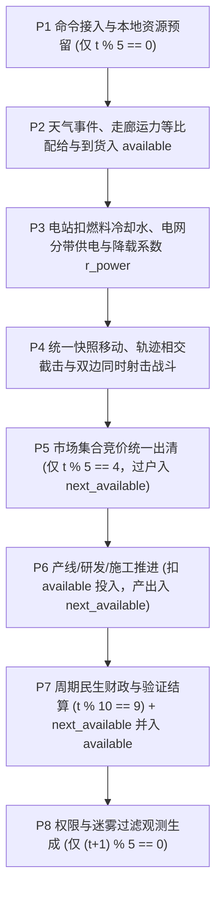

# 双层世界拓扑、三级时序窗口与同 Tick 无偏守恒结算提案

- 作者/任务：主设计与整合（任务 A「世界与时序」+ 任务 F「接口与计算预算」核心底座）
- 状态：已采纳并合入草案 `v0.2`（按用户指示将地图扩大至 `512×512` / `~480` 分区、单局拉长至 `9,600 Tick / 960 周期`、市场定为每窗口出清；见 [../decisions/0002_topology_timing_and_tick_order.md](../decisions/0002_topology_timing_and_tick_order.md)）
- 对应未决问题 ID：`Q03`、`Q06`（同时定义与 `Q02`、`Q07`、`Q13`、`Q17`、`Q22` 的精确接口边界）
- 影响文件与稳定 ID：
  - 确认后拟更新：[../01_world_and_realtime.md](../01_world_and_realtime.md)、[../05_industry_system.md](../05_industry_system.md)、[../06_agent_interface.md](../06_agent_interface.md)、[../07_scoring_and_resources.md](../07_scoring_and_resources.md)、[../08_open_questions.md](../08_open_questions.md)
  - 确认后拟新增决策记录：`decisions/0002_topology_timing_and_tick_order.md`
  - 科技与工业目录稳定 ID：**不增删、不重排任何既有 ID**；直接赋能 `E02`、`E07`、`C02`、`C06`、`C07`、`C08`、`G01`、`G05`、`L04`、`L06`、`N06`、`N08` 的跨系统机制语义，并兼容 [../data/industry.json](../data/industry.json) 既有的 `cycle_ticks = 10` 与 `quantity_precision = 0.001`。

---

## 要解决的问题

当前 `v0.1` 草案在进入经济、军事与评分数值细化前，存在三个必须先锁定的 `P0` 结构性缺口：

1. **大世界空间表达与 64-seed 评测算力的矛盾（`Q03`）**：草案提出 `256×256` 地块（`65,536` 格）、8 个主要国家与 24 个城邦。若把库存、人口、电网、物流寻路与交战全部放在 `65,536` 格上逐 tick 运行，引擎单局寻路与视野开销、跨进程 JSON 观测体积都会急剧膨胀，使策略代码退化为底层网格寻路脚本；反之若完全丢弃二维网格，又会使运河/隧道（`L06`）、港口临水（`L04`）、上下游水文（`A01`）、雷达与近地轨道空间覆盖（`G05`、`N06`、`C08`）失去几何依托。
2. **仿真步（Tick）、决策窗口（Window）与生产周期（Cycle）的关系未锚定（`Q03`）**：[../05_industry_system.md](../05_industry_system.md) 已使用 `1 周期 = 10 tick` 定义全部工期（`8..80` 周期）、维护间隔（`20` 周期）与研究验证时长（`4..32` 周期），但整局总长度、策略交互频率与单局时间预算未定。若每 tick 都跨进程交互数万次，IPC 开销过大且架空本地自治/通信科技；若窗口过疏，则失去即时策略的机动截击与应急调度特征。
3. **同 Tick 跨系统因果顺序与座位遍历偏置未闭合（`Q06`）**：[../01_world_and_realtime.md](../01_world_and_realtime.md) 明确指出需解决“同 tick 新到货能否生产、停电发生前后能否开火、生产完成后何时可出售”，并严禁因遍历国家 `0..7` 或设施列表顺序产生先手优势、透支双花或单 tick 全产业链瞬时级联生产。

---

## 建议的规则或公式

> **状态区分说明**：以下保留用户已确定的全部要求（大世界即时策略、多系统耦合、完整可选科技与工业树、连续百分制、OS 安全随机源默认 64 seed 平均、预留系统 CPU/内存）；具体的地图分层规模、tick/窗口数、毫单位精度账本与预算上限均为**候选可执行规则**，尚未经过原型实测校准。

### 1. 双层世界空间模型（L1 地理栅格 + L2 区域/枢纽拓扑）

将世界空间拆分为严格耦合的两层，兼顾二维空间几何约束与 $O(|V| + |E|)$ 的运行复杂度：

| 层级 | 结构规模（候选） | 承载状态 | 作用的规则子系统 |
|---|---|---|---|
| **L1 地理栅格层** | `256 × 256` 地块（`65,536` 格） | 地形枚举、海拔、耕地潜力、风光系数、流域水文上下游有向图、所属 `region_id`、地形工程状态 | ① `init` 一次性下发（仅在 `L06` 地形工程完工或重大灾害时下发差分）；② 计算跨区真实几何距离与 `E02` 输电线距离损耗；③ 校验港口临水（`L04`）、运河地峡宽度 `<= 3` 格与山脉隧道长度 `<= 4` 格（`L06`）、水利工程上下游影响（`A01`）；④ 计算雷达（`G05`）与轨道节点（`N06`/`N08`）的地面圆形/带状覆盖及山地遮挡 |
| **L2 战略分区与网络层** | `140..180` 陆地分区 + `30..40` 海域/海峡分区 + 同构空域 + `8..12` 近地轨道槽位；约 `110` 座枢纽城市（`Hub`）；`450..550` 条走廊边 | 六维控制权账本、人口群体、设施槽位（`S1–S4`）、分类地点库存、电网母线、在途物流流、军事编队 | ① 库存、设施与人口严格驻留在分区/枢纽，不逐格散落；② 道路、铁路、河运、海运、空运、输电线、输水渠作为**独立类型走廊边**存在于分区之间，运力与通断互不混用；③ 编队位置表示为枢纽驻防 `(region_id, posture)` 或走廊一维连续坐标 `(u, v, progress_mU, length_mU, posture)` |

**控制权账本不变量（为 `Q13` 预留权威数据结构）**：
- **分区控制账本 `RegionControl`**：记录 `sovereign`（主权国）、`controller`（当前有效军事控制方）、`contested`（是否处于交战争夺态）、`local_support[p]`（地方支持度，毫单位 `[0, 1000]`）。
- **资产与走廊控制账本 `AssetControl`**：记录 `owner_shares[p]`（产权份额，非负整数毫单位且严格满足 $\sum_p \text{owner\_shares}[p] = 1000$）、`operator`（唯一当前实际经营方）、`access_acl`（允许通行的势力及优先级档位）。任何占领行为默认仅变更军事控制或冻结敌方经营提取权，不复制产权或凭空接管第三方合同。

### 2. 三级时序架构与固定精度账本

保留 [../data/industry.json](../data/industry.json) 的 `cycle_ticks = 10` 与 `quantity_precision = 0.001`，建立三级锁定比例时钟：

| 时间层级 | 换算关系 | 整局总数（候选） | 职责定义 |
|---|---|---|---|
| **仿真步 `Tick`** | 基本单位（`t = 0 .. 3599`） | `3,600` tick | 编队连续移动与接触截击、视野/雷达刷新、交战回合、电网瞬时供需与降载、在途到货、产线按 `1/10` 周期定额推进进度 |
| **决策窗口 `Window`** | `1 Window = 5 Tick`（`w = 0 .. 719`） | `720` 个窗口 | 在 `t % 5 == 0` 向所有策略同步发送观测并收集命令；窗口内 `5` 个 tick 由引擎按已生效持续计划、优先级和撤退/响应条令自动推进 |
| **工业/财政周期 `Cycle`** | `1 Cycle = 10 Tick = 2 Window`（`c = 0 .. 359`） | `360` 个周期 | 分为早（`0..119`）、中（`120..239`）、晚（`240..359`）三个战略阶段（每阶段 `120` 周期）；结算人口消费、工资税收、研究验证周期计数；每 `20` 周期（`200 tick`）结算一次设施维护（整局共 `18` 次） |

**为什么选择 `360` 周期（`3,600 tick / 720 窗口`）**：
- 对照现有数据目录：`S1/S2/S3/S4` 建设工期分别为 `8/20/40/80` 周期，在 `360` 周期局长下，`S4` 属于必须在中期规划、具有明确回本窗口的重资本决策；64 个科技总理论点为 `51,200` 点（另需 `960` 个验证周期与各级试验包），单国整局合理科研产出约 `10,000..16,000` 点，**无需人为硬上限即可自然迫使玩家在 8 条科技主干间取舍、进口或寻求技术许可（`R06`）**。
- 将决策窗口设为 `5 tick`（每生产周期 2 次决策），既把单局跨进程通信控制在 `720` 次以内，又让窗口间的**本地控制与通信条令**具备不可替代的机制价值。

**全局固定精度整数账本（`Int64 Milli-Unit Ledger`）**：
- 所有库存数量、现金、电量、研究点、行军进度与份额比例统一使用 64 位有符号整数**毫单位（`1 标准单位 = 1,000 mU`）**存储与运算。
- 整机类物资（如 `vehicle`、`locomotive`、`freighter`、`armored_unit`、`satellite` 等平台）在产线内按 `mU` 累积 `wip_output`；每当 `wip_output >= 1000 mU`，向完成缓冲区转出 `wip_output // 1000 × 1000 mU`（整数台），余数留在产线继续生产，切换配方时未满 1 台的半成品进度报废（不返还已消耗电力与工时）。

### 3. 同 Tick 八阶段无偏守恒结算流水线（Zero-Bias Pipeline）

每个枢纽/设施的库存拆分为 **`available`（当步期初可用库存）** 与 **`next_available`（当步新产出/新过户待提交缓冲）**。每仿真步 `t` 严格按 `P1 → P8` 推进，**任何阶段均禁止依赖国家座位号 `0..7` 或实体数组下标决定成败**：

1. **P1 窗口命令校验、通信延迟与本地预留（仅在窗口起点 `t % 5 == 0` 执行）**
   - 采取**逐条命令原子性**：单条非法或版本过期命令仅拒绝自身并返回结构化错误回执，不连坐同批合法命令。
   - **幂等保护**：同一 `client_order_id` 重复提交只返回原状态回执，绝不二次扣款或二次建厂。
   - **本国预算锁**：某国提交的多条命令仅在该国自身账本内按 `(priority, order_index)` 顺序锁定 `reserved_cash` 或本地 `available` 现货；跨国之间在此阶段无共享资源竞争。
   - **通信延迟约束**：若目标编队或远端分区与首都通信链路中断或超载（未覆盖 `C02`/`G01`/`N08`），新命令进入投递队列 `effective_tick = t + comm_delay`，生效前本地实体继续执行既有条令。

2. **P2 环境推进、走廊容量冲突解决与到货入库（每 tick）**
   - 独立确定性随机流更新天气与预约环境事件。
   - 所有在途物流任务同步推进：若某条走廊边 `(u, v, mode)` 当 tick 申请总流量 $D = \sum_i d_i$ 超过走廊当前有效容量 $K$（已计入天气、封锁与损毁）：
     - 先按走廊经营方设定的通行权限档位（如本国军运/紧急调拨档 > 盟友条约保障档 > 普通商贸档）分档满足；
     - 同一档位内若剩余容量 $K_{\text{rem}} < \sum_{i \in S} d_i$，严格按**申请量等比例配给**：
       $$a_i = \left\lfloor \frac{K_{\text{rem}} \cdot d_i}{\sum_{j \in S} d_j} \right\rfloor_{\text{mU}}$$
       剩余不足 $|S|$ 毫单位的整数尾差，按独立物流随机流哈希 `H(seed_log, t, edge_id, task_id)` 排序依次补 `1 mU`。
   - **到货立即可用规则**：任何跨节点运输任务强制满足 `travel_ticks >= 1`。当任务在 `t` 步 P2 走完剩余距离时，卸载货物直接并入目的地 `available`——即 `t_0` 发出的物资最早在 `t_0 + 1` 的 P2 入库，当步即可供 P3 电站烧煤或 P6 工厂投料，既明确可用时点，又杜绝同 tick 跨城瞬移。

3. **P3 电网供需平衡、储能调度与核电冷却（每 tick）**
   - 电站从本地 `available` 扣除 `1/10` 周期定额燃料与水；库存不足时出力按比例降载（`P073` 核电缺冷却水强制降载并累积反应堆热损耗）。
   - 每个连通电网子图汇总当步总发电 + 储能最大可放电功率，扣除输电走廊距离损耗后，按负荷优先级带分配：
     - `Band 1`：核电冷却、雷达探测（`G05`）、通信中继（`C02`/`G01`）、轨道地面站（`N06`）；
     - `Band 2`：城市基础供水医疗、受控环境农场（`P030`）；
     - `Band 3`：工业产线与实验室（解锁 `E07 智能电网` 后允许玩家在 `Band 2/3` 内为单条产线自定义子优先级 `1..9`；未解锁 `E07` 时同带统一承受供电率 $r_{\text{power}} = \min(1, S_{\text{band}} / D_{\text{band}})$）。
   - **停电与开火因果律**：**P3 先于 P4（战斗）和 P6（生产）结算**。期初断燃料或上步电网被毁，当步 P3 立即掉电，雷达掉线与产线降速在当步 P4/P6 即刻体现；当步 P4 交战新炸毁的电力设施，统一从 `t + 1` 步 P3 起改变电网拓扑，确保 P4 内部快照严格一致。

4. **P4 统一快照移动、接触截击与同时射击战斗（每 tick）**
   - 全体编队读取 P3 后的统一快照计算 `[t, t+1]` 在走廊上的位移区间。若敌对编队在同一走廊相向行进且位移区间相交，精确停在最早交汇点 $s^* \in [0, L]$ 进入接触态，不因数组顺序发生“穿模错身”或“谁先踏入节点谁享防御加成”。
   - 同一交战区内的双方基于**同一交战前快照**读取存活单位、供电/通信修正与本地弹药 `available` 库存，同时计算本轮火力输出与弹药消耗，随后一次性同步扣减双方战损、士气、装备耐久和设施附带毁伤，并检查预设撤退阈值（如战损 `>= 25%` 或弹药 `< 10%` 自动脱离）。

5. **P5 市场双边集合竞价与合同交割（每窗口末 `t % 5 == 4` 执行）**
   - 卖单须提前锁定交货枢纽 `H` 的 `available` 现货；买单须锁定 `reserved_cash`。
   - 对每个 `(delivery_hub, good)` 独立执行**统一出清价双边集合竞价（Uniform-Price Call Auction）**：按买价降序与卖价升序求最大成交量区间，取区间中点（毫单位取整）为统一成交价；边际价格档若供需不等，按挂单量等比例配给（尾差哈希决平）。
   - **原地过户原则**：成交后货款即时结算，货物在 `delivery_hub` 原地转入买方 **`next_available`**（于 P7 末转为 `t + 1` 的 `available`）。买方若需运回本国工厂，必须另行占用 `t + 1` 起的真实物理运力。

6. **P6 工业生产、研发、施工与折旧维护（每 tick 按 `1/10` 周期推进）**
   - 处于非转产停机状态的产线，按本地 `available` 原料、P3 供电率 $r_{\text{power}}$、分配劳动力与设备健康度计算当步实际进度 $\Delta x \in [0, c / 10]$，从 `available` 扣除 $a \cdot \Delta x$。
   - **防级联屏障**：所有产线当步产出 $b \cdot \Delta x$（及满 `1000 mU` 下线的整机）**一律写入 `next_available`**。因此 `t` 步刚炼出的钢材最早在 `t + 1` 步进入机械厂投料或在下一窗口（`t + 5`）挂牌出售，**彻底使全球所有设施在 P6 内完全并行、无拓扑顺序依赖**。
   - 当 `(t + 1) % 200 == 0`（每 `20` 周期），检查并扣除设施维护物资；库存不足部分计入设施 `maintenance_debt`，按公开公式降低后续设备可用率。

7. **P7 周期治理财政结算与缓冲区原子提交（每 tick 末提交缓冲；`t % 10 == 9` 附加周期结算）**
   - 在周期末（`t % 10 == 9`）结算地区人口食品/民用品/药品消耗、税款与工资划转、地方支持度迁移、到期承诺合同违约判定、研究验证周期递减与科技解锁。
   - 每个 tick 结束前，原子执行 `available += next_available; next_available = 0`。

8. **P8 权限过滤与迷雾观测生成（`init` 及 `(t + 1) % 5 == 0` 的窗口边界）**
   - 按各国在当前窗口末的有效观测覆盖生成增量观测包，附带观测时间戳、来源类型、精度区间、本窗口命令回执与窗口内关键事件摘要（如 `t+2` 发生电网降载或编队触发自动撤退）。

### 4. 计算、内存与隔离预算目标（关联 `Q07`、`Q22`）

| 指标 | 候选设计参数 | 设计依据与约束 |
|---|---|---|
| 参赛程序交互时限 | `init` `10.0 s`；每窗口 `0.5 s`；整局独立超时池 `90.0 s`；整局总预算上限 `450.0 s` | 沿用题库成熟的时间池容错范式；超时窗口按空命令 `{}`（继续既有持续计划）处理，累计未响应 `>= 40` 次后续窗口转为空命令托管 |
| 观测消息体积上限 | `init <= 250 KiB`；常规窗口增量 `obs <= 25 KiB`；每 `20` 窗口恢复快照 `<= 80 KiB` | L1 静态地形仅 `init` 发送一次；常规窗口只发本国账本与视野内变化实体（带 `entity_version` 与 `deleted_ids`），保证 720 窗口总 I/O `< 25 MiB`/局 |
| 单局进程与内存目标 | 引擎 + 7 个内置参考策略 + 1 个外部参赛子进程峰值目标 `< 512 MiB`；并发调度预估配额 `768 MiB`/局 | 外部参赛程序运行于独立受限子进程（禁止联网、只读最小运行环境、不可见裁判内存与其他 seed 目录）；OS 层硬内存上限需由 Linux cgroup v2 / Windows Job Object 实现，调度预估本身不充当安全边界 |

---

## 玩家会因此作出什么不同选择

1. **前置战备库存 vs 零库存即时供应链（跨产业 + 物流 + 军事）**：由于 P6 的 `next_available` 屏障与 P2 的 `travel_ticks >= 1` 物理时延，一条“铁矿 → 钢材 → 基础化学品/弹药 → 前线编队”链条从投料到前线开火至少跨越数个生产周期与运输窗口。玩家不能在遇袭当 tick 靠现金瞬间买出弹药守城，必须在和平期权衡“前线野战仓库（`G02`）囤积弹药燃油占用的资金/仓储维护”与“突发封锁断供风险”。
2. **本地自动化/通信投资 vs 中央微操（跨科技 + 电网 + 指挥）**：因为决策窗口每 `5 tick` 一次，未研发 `E07 智能电网` 的国家在窗口中途遭遇风光骤降（`P072`）或线路被袭时，工业与非核心负荷会被一刀切降载，导致高价值晶圆/验证产线停摆；研发并部署 `E07`、`C06`、`G01` 与 `C07` 的玩家则能预设细粒度断电保护带、跨厂排程与交战撤退阈值，在窗口内部快节奏突变中保持系统韧性。
3. **地形咽喉工程与控制权博弈（跨地理 L1 + 物流 L2 + 外交）**：海运干线受海峡分区限制，陆运受山脉走廊容量限制。玩家可以投资 `L06 大型地形工程` 在本国地峡开凿运河改变全球最短海运拓扑，或与邻国签署带优先级档位的走廊通行合同（P2 分档等比配给），使基础设施成为长期地缘筹码而非一次性装饰建筑。

---

## 输入、输出与跨系统依赖

- **本提案锁定的下游公共基准（输出给任务 B/C/D/E/F）**：
  1. 统一时间常数：`1 Cycle = 10 Tick = 2 Window`（整局候选 `3,600 Tick = 720 Window = 360 Cycle`）；
  2. 统一数值精度：`int64` 毫单位（`1 unit = 1,000 mU`）；
  3. 统一空间挂载点：自然资源矿脉、设施槽位、人口群体、电网母线挂载于 `Region / Hub`；距离损耗、视野遮挡与工程选址读取 `256×256` L1 栅格；物流与行军挂载于多模态 `Corridor`；
  4. 统一同 tick 因果律：`P1 命令锁 → P2 到货 → P3 供电 → P4 战斗 → P5 市场 → P6 生产 → P7 民生与缓冲提交 → P8 观测`。
- **需要下游任务继续补齐的输入依赖**：
  - **任务 B（产业与科技，`Q04`/`Q05`/`Q08`/`Q17`）**：基于 `Region/Hub` 给出 12 种自然资源的采掘设施投入与储量衰减公式、各类走廊（公路/铁路/港口/电网）建设材料与每 tick 运力参数、人口单位换算与基础消费/财政闭环。
  - **任务 C（军事与情报，`Q12`/`Q16`/`Q18`）**：基于 P4 同时射击框架给出编队槽位、弹药燃油消耗率、交战伤害/士气公式，以及基于 L1 几何距离的雷达/轨道观测误差模型。
  - **任务 D（治理与外交，`Q13`/`Q14`/`Q15`）**：给出 `RegionControl` 与 `AssetControl` 在战争占领、国有化、合资、条约违约时的状态转移表及地方支持度公式。
  - **任务 E（评测与对抗审查，`Q01`/`Q02`）**：基于早/中/晚三阶段（`120/240/360` 周期）与终局状态定义抗刷分原始国力 $V$，并确定 64 seed 在 8 国地图上的座位分配与参考基准方案。

---

## 边界情况与可被利用的漏洞

| 潜在漏洞 / 边界情况 | 本提案的防御机制 |
|---|---|
| **座位号先后手套利**（如 0 号国先抢光市场低价铁矿、先占满走廊运力、先开火秒杀残血敌军） | P2 运力冲突采用同档等比例配给 + 独立哈希尾差；P4 移动求连续轨迹交点、交战基于同快照同时射击；P5 市场采用窗口末统一出清价双边集合竞价；彻底消除数组遍历先后手 |
| **同 tick 跨城买货瞬移 / 零库存空卖** | 卖单挂出即冻结交货枢纽 `available` 现货；P5 成交仅在交货枢纽原地转入买方 `next_available`，跨城使用必须走 `travel_ticks >= 1` 的 P2 物理运输 |
| **单 tick 全产业链级联暴兵**（同城原料到成品在 1 tick 内连环结算） | P6 所有产出强制进入 `next_available`，至 P7 末才并入 `available`，任何上下游工序之间至少相隔 `1 tick` 物理在制品（WIP）周期 |
| **拆单舍入凭空刷物资**（如利用 `0.0006 -> 0.001` 反复微批量生产或交易） | 全账本采用 `int64` 毫单位向下取整扣减与累积，半成品进度留存产线，集合竞价与运力余数严格守恒（$\sum a_i = K_{\text{rem}}$），零浮点创生 |
| **利用重发命令或超额挂单复制购买力** | P1 按 `client_order_id` 幂等去重，所有挂单与建造在 P1 即刻冻结 `reserved_cash` / `reserved_stock` |
| **无关动作扰动全局随机数**（如多发一条侦察指令改变下一场台风或矿脉） | 按 [../01_world_and_realtime.md](../01_world_and_realtime.md) 要求，将天气、市场背景、各走廊运力尾差、各交战区战斗随机流按 `(world_seed, stream_tag, tick, location_id)` 哈希派生（计数器式确定性 PRNG），互不串流 |

---

## 替代方案与代价

1. **替代方案 A：纯 `256×256` 逐格全状态仿真（不设 Region/Hub 拓扑层）**
   - *优点*：微操自由度极高，可任意逐格摆厂与包抄。
   - *放弃原因*：64 seed × 8 国评测的寻路、供电连通与 JSON 观测开销过高，且会把评测重心从“国家宏观战略与多系统权衡”拉向“二维网格寻路与微操工程量”，违背 [../00_design_principles.md](../00_design_principles.md)。
2. **替代方案 B：`1 Window = 1 Tick`（每 tick 均与外部策略进程交互，`3,600` 次/局）**
   - *优点*：策略可每 tick 瞬时响应一切局部变化。
   - *代价与权衡*：跨进程序列化开销增大 `5` 倍，且策略可用每 tick 手动改单绕过本地自动控制/通信科技（`E07`、`C06`、`C07`、`G01`）的设计意义。若用户更偏好每 tick 交互，可将总 tick 压缩至 `1,800`（`1 Cycle = 5 Tick`）作为备选，但当前 `5 tick/窗口` 更契合多系统条令式指挥。
3. **替代方案 C：仅在生产周期末（每 `10 tick`）一次性跳变结算工业产出**
   - *代价*：周期中途停电或断料难以平滑折算，容易引发玩家在 `t % 10 == 0` 单点卡秒开关电厂的微操套利；按每 tick `1/10` 周期连续累积毫单位进度可彻底消除卡周期边界套利。

---

## 已做检查和证据

- 对照 [../data/technology.json](../data/technology.json) 与 [../data/industry.json](../data/industry.json) 核算了全部 64 项科技理论点（总计 `51,200` 点）、验证周期、4 档设施工期（`8/20/40/80` 周期）与维护间隔（`20` 周期），确认 `360` 周期（`3,600 tick`）能使早/中/晚三阶段投资回报窗口自然拉开，且保持 `cycle_ticks = 10`、`quantity_precision = 0.001` 原地兼容。
- 核算了 `720` 窗口 × `160..220` 分区节点图在逐行 JSON 协议下的单局增量载荷与状态规模，确保通信与内存开销处于合理可控范围。
- 运行 `python tools/catalog.py check` 验证目录引用、科技无环性与本地文档链接完整性。

---

## 尚未验证或仍需决策

1. **待你拍板的核心参数确认点**：
   - 空间架构采用「`256×256` L1 地理栅格 + `~180` 分区 L2 网络拓扑」双层模型是否符合你的预期？
   - 时序采用「整局 `3,600 tick` = `720` 决策窗口（每 `5 tick` 一窗）= `360` 工业周期（每 `10 tick` 一周期）」是否合适？（抑或希望更长/更短？）
   - 市场集合竞价频率采用「每窗口一次（`5 tick`）」还是「每生产周期一次（`10 tick`）」？
2. **尚未完成的验证**：尚未编写原型引擎测量真实单局耗时与峰值内存；64 seed 下的 8 国座位公平方案与国力 $V$ 具体权重留待下一份 `P0` 提案（`Q01`/`Q02`）专项锁定。
