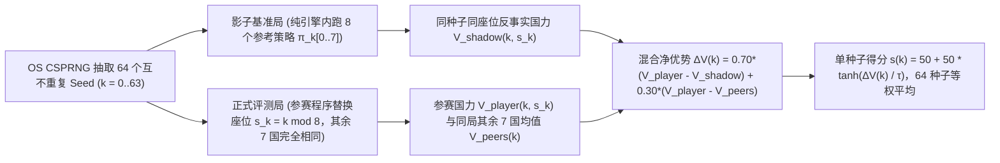

# 抗刷分原始国力公式 $V$、四纪元可持续积分与 8 国反事实座位公平提案

- 作者/任务：主设计与整合（任务 E「评测与对抗审查」核心方案）
- 状态：已采纳并合入设计规范（见 [../decisions/0003_national_power_and_seat_fairness.md](../decisions/0003_national_power_and_seat_fairness.md)）
- 对应未决问题 ID：`Q01`、`Q02`（衔接 [../decisions/0002_topology_timing_and_tick_order.md](../decisions/0002_topology_timing_and_tick_order.md) 的 `512×512` 超大陆、`960` 周期四纪元时钟与 `int64` 毫单位账本）
- 影响文件与稳定 ID：
  - 确认后拟更新：[../07_scoring_and_resources.md](../07_scoring_and_resources.md)、[../08_open_questions.md](../08_open_questions.md)、[../CHANGELOG.md](../CHANGELOG.md)
  - 确认后拟新增决策记录：`decisions/0003_national_power_and_seat_fairness.md`
  - 科技与工业目录稳定 ID：**不增删、不重排任何既有 ID**；直接基于 [../data/technology.json](../data/technology.json) 的 64 项科技阶数与 [../data/industry.json](../data/industry.json) 的 79 种物品基准要素成本派生固定目录影子权重。

---

## 要解决的问题

在 `512×512` 多大陆、8 个主要国家 + `36..48` 个城邦、`9,600 Tick`（`960` 工业周期）的大尺度设定下，正式计分系统必须同时解决两大 `P0` 难题：

1. **原始国力 $V$ 极易被代理指标刷分（`Q01`）**：
   - 若计入名义现金或贸易成交总额，策略可与盟友或本国分城之间做零成本“自买自卖对倒”刷出无限 GDP；
   - 若计入仓库总库存或累计总产量，策略可无脑狂挖石头囤积百万水泥，或反复“建造—拆解 `S1` 回收废钢”空转刷工业分；
   - 若只看第 `960` 周期瞬时面板，策略会在最后 `60` 周期停掉全部维护、停掉科研、断供国民口粮做“末日冲刺”；若只看全程简单累加，早期速攻掠夺流即便在后期引发资源枯竭与国内崩溃也能靠前期积分躺赢；
   - 若按占领格数给控制分、按已解锁科技数给科技分、按签约数量给外交分，则会出现“圈无人荒漠”“研究潜艇却从不下水”“签几十份零交易空头同盟”的虚假繁荣。
2. **8 国非对称大陆下的座位运气偏差与损人不利己操纵（`Q02`）**：
   - 多大陆随机种子下，内陆矿业国、海峡枢纽国与群岛海权国的开局地理上限天然存在差异；若简单用本局其余 7 国平均国力做 $V_{\text{reference}}$，抽到劣势座位的种子会产生巨大方差；
   - 更严重的是，若 $V_{\text{reference}}$ 仅取决于同局对手，玩家可能采取**自杀式焦土搅局**（自损 `10` 分把邻国炸掉 `15` 分，使自身相对同局均值反而上升），扭曲国家发展目标；而若在每个 seed 上把全部 8 个座位轮换重跑一遍，`64 × 8 = 512` 场大世界长局又会使评测算力成本暴涨 8 倍。

---

## 建议的规则或公式

> **状态区分说明**：保留用户已锁定的连续 `0–100` 百分制、默认 64 个 OS 安全随机源 seed 平均、同批共享样本及 `50 + 50 * tanh(...)` 连续映射方向；以下五大支柱精确公式、四纪元权重、固定目录影子价格及“同种子同座位反事实基准”均为**候选可执行规则**，尺度常数需在未来原型建立后通过独立校准集冻结。

### 1. 不随市场波动的固定目录影子价值表 $w_g^{\text{cat}}$

为彻底切断“操纵市场成交价抬高本国产值”的路径，所有实物增值与贸易交付的计分估值一律采用由 [../data/industry.json](../data/industry.json) 静态配方图唯一派生的**目录基准影子权重 $w_g^{\text{cat}}$**（不随局内现货价格变化）：

- **源头自然资源基准值**：普通大宗矿石/石料/水/生物质设为基准区间 `1.0 .. 2.0`，能源矿（煤/油/气）设为 `2.5 .. 3.5`，战略稀缺矿（石英/稀有矿/铀矿）设为 `5.0 .. 8.0`；废钢/废铜固定设为钢材/铜材影子价值的 `0.45`（严格低于冶炼产成品，确保“建厂再拆解”净增值为负）。
- **合成物品递归基准值**：对每个工业品 $g$，取生产 $g$ 的基准人工线配方（`general`）计算要素投入成本：
  $$w_g^{\text{cat}} = \min_{r:\, g \in \text{out}(r)} \frac{\sum_{i} a_{r,i} w_i^{\text{cat}} + \alpha_E p_r + \alpha_L w_r + \alpha_K \text{grade}(r)}{b_{r,g}}$$
  其中 $(\alpha_E, \alpha_L, \alpha_K)$ 为全局冻结的基准电价、工时与设施折旧权重（多产物配方如 `P006 原油炼制` 按固定物理当量分摊）。该表在 `init` 中完全公开。

### 2. 单周期瞬时综合国力 $U_p(c)$ 的五大支柱（每周期 `c = 0 .. 959` 结算一次）

令 $P_0$ 为该世界开局 8 个主要国家的平均初始人口规模，用于将各支柱统一归一化到无量纲可比尺度（基准开局国约 `100` 点量级）：

$$U_p(c) = 0.25\, U_p^{\text{pop}}(c) + 0.25\, U_p^{\text{ind}}(c) + 0.20\, U_p^{\text{ctrl}}(c) + 0.15\, U_p^{\text{tech}}(c) + 0.15\, U_p^{\text{intl}}(c)$$

#### （1）支柱一：国民福祉与本土安全 $U_p^{\text{pop}}(c)$（权重 `25%`）
$$U_p^{\text{pop}}(c) = 100 \cdot \sum_{r:\, \text{ctrl}(r)=p} \psi_{\text{legit}}(p, r, c) \cdot \frac{\text{Pop}_r(c)}{P_0} \cdot Q_{\text{life}}(r, c) \cdot Q_{\text{sec}}(r, c)$$
- **治理合法性系数 $\psi_{\text{legit}}(p, r, c)$**：本国主权且有效控制且地方支持度达标时趋近 `1.0`；纯军事占领但无主权、地方支持度低迷的被占区仅在 `[0.15, 0.50]` 之间（防止靠暴力圈占敌国人口瞬时暴涨民生分，必须长期治理赢得地方支持才能充分转化）。
- **实际消费生活质量 $Q_{\text{life}}(r, c) \in [0, 1.5]$**：仅统计当周期居民**实际消耗入腹/入户**的 `food`（硬底线乘子：口粮满足率 `< 80%` 时 $Q_{\text{life}}$ 二次方骤降）、`consumer_goods`、`medicine` / `medical_supplies` 与市政水电满足度，采用凹函数边际递减合成（过量倾销民用品不无限涨分）。
- **安全系数 $Q_{\text{sec}}(r, c) \in [0, 1]$**：当周期本区遭受地面交战、轰炸封锁或严重污染时按受损比例扣减。

#### （2）支柱二：可持续净生产与有效物流增值 $U_p^{\text{ind}}(c)$（权重 `25%`）
$$U_p^{\text{ind}}(c) = \kappa_{\text{ind}} \left( \sum_{f} \text{owner\_share}_p(f) \cdot \text{VA}_{\text{eff}}(f, c) + \beta_{\text{transit}} \cdot \text{NetTransit}_p(c) \right)$$
- **有效实物净增值 $\text{VA}_{\text{eff}}(f, c)$**：产线当周期按目录影子权重计算的 $\max(0,\, \sum b_g w_g^{\text{cat}} - \sum a_g w_g^{\text{cat}}) \cdot \Delta x_f(c)$，**乘以“有效去向消纳率” $\eta_{\text{sink}}(g, c) \in [0, 1]$**：
  - 若产出被国内民生/施工/科研/维持消耗、或已实际交割出口给非关联国，消纳率为 `1.0`；
  - 若某中间品/建材在国内总库存已超过本国近 `20` 周期实际平均消耗量的 `6` 倍（安全战略储备上限），超额累库部分的当期计分消纳率平滑衰减至 `0`！**直接根除“挖石头狂造无用水泥堆满荒漠仓库”的刷分漏洞**。
  - 合资设施严格按 `owner_shares[p]`（总和为 `1`）线性切分增值，绝不双重计分。
- **反乒乓对倒的净物流服务 $\text{NetTransit}_p(c)$**：对每条走廊边 $(u, v)$ 与每种货物 $g$，仅统计窗口内**净单向物理流量** $|\text{Flow}(u \to v, g) - \text{Flow}(v \to u, g)| \cdot w_g^{\text{cat}} \cdot \text{dist}_{uv}$ 中由 $p$ 国运营车船/港口/运河承运的份额（两城之间来回空转同一批货物的净流量恒等于 `0`）。

#### （3）支柱三：有效战略空间、基础设施与投送控制 $U_p^{\text{ctrl}}(c)$（权重 `20%`）
- **摒弃纯格子面积计分**：每个陆海分区 $r$ 的客观战略权重 $\sigma(r, c)$ 由三项实际功能构成：① 本区当期实际资源采掘与可再生采集产出；② 已开发且通水通电的城市设施槽位；③ 经过本区走廊/海峡/运河的全球净贸易与补给流量。**无人无矿无航道的荒漠或远洋空白格 $\sigma(r, c) = 0$**。
- **有效控制乘子**：必须同时满足 `controller == p`、与本国核心补给网连通（`supply_connected == true`）且基础设施未处于瘫痪状态；外加本国健康完好的跨区铁路/港口/运河/电网资产折旧后净值、在轨有效工作卫星（`N06`/`N08`）覆盖权重，以及**补给充足且处于战备阈值以上的现役编队实力（超出本国和平后勤承载上限的穷兵黩武部分边际收益归零）**。

#### （4）支柱四：已落地技术应用深度 $U_p^{\text{tech}}(c)$（权重 `15%`）
$$U_p^{\text{tech}}(c) = \kappa_{\text{tech}} \sum_{t \in \text{Verified}_p(c)} \text{TierWeight}(t) \cdot \Big( 0.15 + 0.85 \cdot \min\!\big(1,\; \frac{\text{ActiveScale}_{p,t}(c)}{\Theta_t}\big) \Big)$$
- 完成某项科技验证本身仅获得 **15% 的知识储备底分**；其余 **85% 必须通过当期真实规模化运行 $\text{ActiveScale}_{p,t}(c)$ 解锁**（例如：解锁 `I05 自动化装配` 须有正在供电运转的 `automated` 产线；解锁 `L06 大型地形工程` 须有已贯通通航的运河/隧道；解锁 `N06/N08` 须有在轨正常工作的卫星；解锁 `R06` 可计入他国正实际运行本国授权配方的规模）。停电闲置或纸面囤积科技无法拿满应用分。

#### （5）支柱五：国际履约信用、外部耦合与城邦凝聚力 $U_p^{\text{intl}}(c)$（权重 `15%`）
$$U_p^{\text{intl}}(c) = \text{Credit}_p(c) \cdot \left( \kappa_{\text{exp}} \cdot \text{RealizedNetTradeValue}_p(c) + \kappa_{\text{cs}} \sum_{m \in \text{CityStates}} \omega_m \cdot \text{Align}_{m \leftarrow p}(c) + \kappa_{\text{ally}} \cdot \text{RealizedMutualAid}_p(c) \right)$$
- **净贸易与跨国分工实绩**：按固定目录权重 $w_g^{\text{cat}}$ 核算与外国/城邦完成的**净互补实物交割**（即各品类 $|\text{Export}_{p,g} - \text{Import}_{p,g}|$ 之和，同一周期既买钢又卖钢的对倒部分直接抵消为 `0`！）。
- **中立城邦真实依托度 $\text{Align}_{m \leftarrow p}(c)$**：`36..48` 个中立城邦按各国为其提供的实际口粮能源保障、过境贸易收入与安全协防计算归一化依托权重（$\sum_p \text{Align}_{m \leftarrow p} \le 1$）。
- **国际信用硬门槛 $\text{Credit}_p(c) \in [0.1, 1.0]$**：背弃行为承诺合同将直接削减 $\text{Credit}_p(c)$，使整个国际影响力支柱按比例打折。空头零流量条约在公式中贡献恒为 `0`。

### 3. 四纪元轨迹积分 + 终局可持续性折现因子（`960` 周期全过程汇总）

将 `960` 个工业周期等分为四个各长 `240` 周期的战略纪元：
- **纪元 I（奠基期，`c = 0 .. 239`）**、**纪元 II（扩张期，`c = 240 .. 479`）**、**纪元 III（转型期，`c = 480 .. 719`）**、**纪元 IV（决胜期，`c = 720 .. 959`）**，另记最后 `40` 周期（`c = 920 .. 959`，涵盖最后两次 `20` 周期设施大维护）均值为终局稳态 $U_p^{\text{end}}$。

原始总国力 $V_p$ 定义为**递增纪元积分 + 可持续终局锚点**：
$$V_p = 0.08\,\bar{U}_{p,\text{I}} + 0.14\,\bar{U}_{p,\text{II}} + 0.24\,\bar{U}_{p,\text{III}} + 0.29\,\bar{U}_{p,\text{IV}} + 0.25\, U_p^{\text{end}} \cdot \Phi_{\text{sustain}}(p)$$

其中 **终局可持续性乘子 $\Phi_{\text{sustain}}(p) \in [0.35, 1.00]$** 专门猎杀“终局前停维护、断粮、举债暴兵”的末日套利：
$$\Phi_{\text{sustain}}(p) = \max\!\Big(0.35,\; 1 - d_{\text{maint}}(p) - d_{\text{shortage}}(p) - d_{\text{unrest}}(p) - d_{\text{insolvency}}(p)\Big)$$
- $d_{\text{maint}}$：终局全国设施累计未偿 `maintenance_debt` 占总资产比例惩罚；
- $d_{\text{shortage}}$：终局最后 `20` 周期全国口粮、基础电力与现役编队最低补给断供率惩罚；
- $d_{\text{unrest}}$：核心主权地区地方支持度崩盘或处于失控暴动状态的惩罚；
- $d_{\text{insolvency}}$：国家处于财政违约破产重整状态或逾期未清偿托管债务的惩罚。

### 4. 8 国非对称世界的座位公平与反搅局设计（同种子同座位反事实混合基准）

针对 `Q02` 的座位偏差与多人局搅局问题，提出 **“分层轮换座位 + 同种子全参考影子局（Shadow Counterfactual）”** 机制：

1. **8 风格固定参考池与分层座位分配**：
   - 组委会冻结 8 个覆盖不同战略路线的强参考策略池 $\mathcal{B} = \{B_0, \dots, B_7\}$（工业自动化型、远洋贸易型、资源能源型、高科许可型、城邦联盟型、装甲陆权型、海空封锁型、均衡适应型）。
   - 对第 $k \in \{0, \dots, 63\}$ 个种子，由 `seed_k` 确定性洗牌生成参考席位映射 $\pi_k$，并将待测选手固定安排在座位 $s_k = k \bmod 8$（使 64 个种子中每个座位号精确出现 `8` 次）。
2. **双局对照与混合净优势 $\Delta V(k)$**：
   - **全参考影子基准局（Shadow Run）**：在 `seed_k` 上由 $\pi_k[0..7]$ 全部 8 个内置参考策略纯引擎内运行一局，记录原座位参考策略 $\pi_k[s_k]$ 在完全相同地理开局与邻居包围下取得的国力 $V_{\text{shadow}}(k, s_k)$。**注：同批评测多个参赛模型时，这 64 场无外部 IPC 的影子局只需计算 1 次即可全局复用！**
   - **选手评测局（Eval Run）**：待测策略接管座位 $s_k$，其余 7 个座位的参考策略及全部随机流种子保持完全不变，测得选手国力 $V_{\text{player}}(k, s_k)$ 及同局其余 7 国平均国力 $\bar{V}_{\text{peers}}(k) = \frac{1}{7}\sum_{j \neq s_k} V_j^{\text{eval}}(k)$。
   - **混合净优势与百分制映射**（候选混合系数 $\lambda = 0.70$）：
     $$\Delta V(k) = 0.70 \cdot \big(V_{\text{player}}(k, s_k) - V_{\text{shadow}}(k, s_k)\big) + 0.30 \cdot \big(V_{\text{player}}(k, s_k) - \bar{V}_{\text{peers}}(k)\big)$$
     $$s(k) = 50 + 50 \cdot \tanh\!\left(\frac{\Delta V(k)}{\tau}\right), \qquad S_{\text{final}} = \frac{1}{64} \sum_{k=0}^{63} s(k)$$
   - **数学性质验证**：
     - **零偏基准性**：若把参考池自身投入测试，$\mathbb{E}[\Delta V(k)] = 0 \implies \mathbb{E}[S_{\text{final}}] = 50.0$ 分；
     - **消除地形优劣运气**：若座位 $s_k$ 开局地处苦寒内陆导致所有策略在此座上限偏低，$V_{\text{shadow}}(k, s_k)$ 同步偏低，`70%` 权重当场抵消地形偏差，剩余 `30%` 跨 64 种子均衡平滑；
     - **免疫自杀式焦土搅局**：若选手自损 `-15` 分把周围邻居总共拖垮（使 $\bar{V}_{\text{peers}}$ 降 `-20` 分），由于影子局的 $V_{\text{shadow}}$ 完全不受选手本局破坏影响，$\Delta V = 0.70 \times (-15) + 0.30 \times (+5) = -9.0 < 0$，**损人不利己严格亏分**；
     - **兼容正和合作与有效竞争**：与盟友互利贸易（己 `+15`，一盟友 `+14` 即 $\bar{V}_{\text{peers}}$ 仅升 `+2`）得 $\Delta V = 0.70 \times 15 + 0.30 \times 13 = +14.4 > 0$；以低代价封锁关键海峡遏制头号强敌（己 `+5`，强敌 `-14` 即 $\bar{V}_{\text{peers}}$ 降 `-2`）得 $\Delta V = 0.70 \times 5 + 0.30 \times 7 = +5.6 > 0$。**既奖励共赢外交，也奖励高性价比战略遏制**。
3. **灭国、破产与技术崩溃的计分闭合**：
   - 游戏内失去全部控制分区（灭国）或财政破产：不提前终止世界仿真，其此后周期瞬时国力 $U_p(c)$ 自然归零（或仅保留残存流亡资产），此前各纪元已取得的真实历史贡献仍按公式保留，从而连续区分“抵抗到第 750 周期惜败”与“开局第 50 周期速崩”。
   - 玩家进程崩溃/超时超限：按接口规则转为空命令 `{}` 托管跑完剩余周期并如实计分（附带报告异常计数），绝不报错中断评测；裁判或宿主机故障则整批标记无效，严禁删局重算均值。

---

## 玩家会因此作出什么不同选择

1. **从“末日寅吃卯粮”转向“跨纪元矿产接替与维护规划”**：在 `960` 周期的四纪元权重（后两纪元 + 终局共占 `78%`）与 $\Phi_{\text{sustain}}$ 约束下，早期本土浅层富铁矿与油田在纪元 III 前后逐渐衰竭时，玩家必须提前在纪元 II 布局远洋港口货船（`L04`）开拓海外城邦矿源，或研发 `I08 闭环回收`、`E05 核能`、`A06 生物化工` 完成产业换血，且绝不敢在终局前停缴 `S3/S4` 维护件。
2. **从“盲目铺摊涂色”转向“咽喉节点与高消纳产业链”**：荒漠无人区 $\sigma(r, c) = 0$ 且低支持度占领区合法性折价高、治安补给消耗大，盲目吞并贫瘠敌占区反而拖累 $U^{\text{pop}}$ 与 $U^{\text{ind}}$；相反，精准控制海峡良港、开凿一条高流量地峡运河（`L06`）或与 `36..48` 个中立城邦建立稳定工农互补贸易，能同时拉升 $U^{\text{ind}}$、$U^{\text{ctrl}}$ 与 $U^{\text{intl}}$。
3. **从“锁科技树刷点数”转向“学以致用与许可输出”**：由于未实际投产运行的科技只能拿到 `15%` 底分，玩家若缺乏超净基材与稀有矿，不会硬点 `C04 先进制程` 摆设，而会聚焦把成熟芯片自动化线（`C03 + I05`）铺满全国工厂，或通过 `R06 技术转化` 将已掌握科技授权给盟国换取矿产长协并共享应用规模分。

---

## 输入、输出与跨系统依赖

- **本提案锁定的输出接口**：
  - 向任务 B（产业与经济）输出：固定目录影子权重表 $w_g^{\text{cat}}$ 的生成原则、超额库存 `6` 倍消纳衰减边界与终局维护/断供惩罚项；
  - 向任务 C/D（军事、治理与外交）输出：地区战略价值 $\sigma(r, c)$、占领合法性折算 $\psi_{\text{legit}}$、净互补外贸额、城邦依托度 $\text{Align}_{m \leftarrow p}$ 及国际信用乘子 $\text{Credit}_p$ 的计分钩子。
- **需要下游任务继续闭合的参数**：
  - 任务 B（`Q04`/`Q05`）：居民标准消费篮子定量需求、财政破产重整精确触发阈值；
  - 任务 D（`Q13`/`Q14`/`Q15`）：`local_support` 与 `Credit` 的具体周期递推方程。

---

## 边界情况与可被利用的漏洞

| 对抗性刷分手法 | 公式中的结构性免疫机制 |
|---|---|
| **双城/跨国乒乓运货刷物流吨公里** | $\text{NetTransit}$ 取同一边同品类正反向流量的绝对差 $|\text{Flow}_{u\to v} - \text{Flow}_{v\to u}|$，往返对冲恒为 `0` |
| **与盟友低买高卖或自买自卖刷外贸额** | 估值锁定静态目录权重 $w_g^{\text{cat}}$（无视成交报价），且外贸仅计单品类净出口/净进口绝对差 $|\text{Exp}_g - \text{Imp}_g|$ |
| **狂挖廉价石料造水泥堆满全国刷工业产值** | 超出本国 `20` 周期真实消耗均值 `6` 倍的累库部分，$\eta_{\text{sink}}$ 衰减至 `0`，无消纳空转产线不产分 |
| **反复建造再拆解 `S1` 设施刷回收配方增值** | 拆解仅返 `50%` 直接金属且废钢影子权重设为钢材的 `0.45`，拆建循环净增值为负且白白损耗水泥与机件 |
| **最后 30 周期停维护、裁撤后勤、饿肚子冲峰值** | $U^{\text{end}}$ 取最后 `40` 周期（跨两次维护结算点）均值，并乘以严厉的 $\Phi_{\text{sustain}}$ 欠账/断供/动乱折现 |
| **自杀式焦土战术拖垮邻国抬高相对排名** | `70%` 权重锚定不受选手干扰的同种子全参考影子局 $V_{\text{shadow}}(k, s_k)$，损人不利己直接导致 $\Delta V < 0$ |

---

## 替代方案与代价

1. **替代方案 A：每 seed 让参赛者轮流坐满全部 8 个座位（`64 × 8 = 512` 场）**
   - *优点*：单种子内座位方差完全归零。
   - *放弃原因*：在 `512×512` + `9,600 Tick` 长局下，单次评测算力成本暴增 `8` 倍；采用“64 种子分层座位 + 1 场无 IPC 内置影子基准局”，仅增加约 `15%..25%` 引擎开销（多模型同批评测时开销更是摊薄至近零），即可消除绝大部分座位运气偏差。
2. **替代方案 B：100% 采用影子局差值（$\lambda = 1.0$，完全不看同局其余 7 国得分）**
   - *代价*：若完全不看同局对手得分，战略封锁、切断强敌能源通道等合理大国竞争手段对敌造成的削弱不再有任何相对评价体现；取 $\lambda = 0.70$ 兼顾了反焦土搅局与大国博弈竞争性。

---

## 已做检查和证据

- 逐一核对了 [../07_scoring_and_resources.md](../07_scoring_and_resources.md) 与 [../08_open_questions.md](../08_open_questions.md) 列出的全部反套利场景（人口规模、无人区占领、转移支付、库存估值、纸面联盟、关联方交易、囤积无用科技、清算弱国与帮助参考势力），确保每一类漏洞均有显式数学项封堵。
- 运行 `python tools/catalog.py check` 验证提案相对链接与全目录一致性。

---

## 尚未验证或仍需决策

1. **待你拍板的核心决策点**：
   - 五大支柱权重（`民生安全 25% / 净生产物流 25% / 有效战略控制 20% / 落地技术应用 15% / 国际履约与城邦影响 15%`）与四纪元 + 终局权重配比是否符合你的设计倾向？
   - 采用“64 种子分层轮换座位 + 同种子全参考影子局反事实基准（`70%` 同座超越分 + `30%` 同局领先分）”解决 8 国座位公平与防搅局，是否认可？
2. **待原型阶段校准的参数**：尺度常数 $\tau$、目录要素权重 $(\alpha_E, \alpha_L, \alpha_K)$ 与 8 个参考策略池的实际强度分布需在引擎实现后通过独立校准种子集实测冻结。
